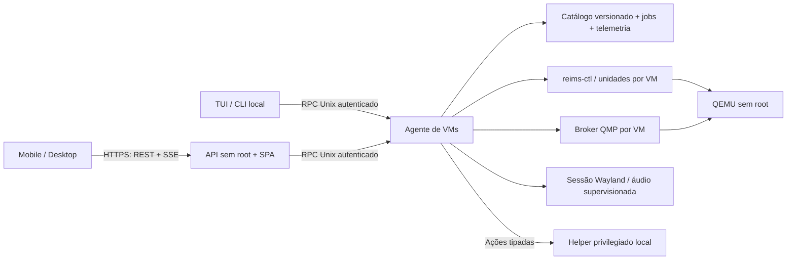

## Context

Ver `proposal.md` para a motivação. Decisões confirmadas pelo usuário: formulários completos para o fluxo vHackintosh com editor avançado para demais opções QEMU; várias VMs simultâneas conforme recursos; energia restrita à VM por padrão; tema futurista baseado no site público do projeto.

### Evidências do checkout

| Área | Estado observado e consequência |
| --- | --- |
| Catálogo | `core/config.py` mantém `VMConfig` e `vms.json`, com gravação atômica e proteção de identidade. `from_dict` descarta campos desconhecidos; extensões novas precisam de representação persistente explícita. Escrita atômica sozinha não impede atualização perdida entre processos. |
| Concorrência | Apesar do nome, `ExclusiveVMLock` já reserva memória por VM com `flock`, considera processos existentes e margem do host. `docs/soul.md` ainda descreve uma VM ativa; a implementação é a referência para esta decisão. |
| Runtime | `core/reims_ctl.py` registra a VM no catálogo Reims e escreve `vm.toml`. O escritor atual reconstrói grande parte do TOML e fixa `extra_args`; precisa preservar opções avançadas, MAC e parâmetros que o painel editar. O argv QEMU pertence ao `reims-ctl`. |
| GPU | O vHackintosh persiste PCI BDF, mas `_icd_para_slot` resolve por vendor/device e grava principalmente `driver_file`. Na árvore local `/home/felipeab10/reims-vgpu`, `crates/reims-ctl/src/gpu.rs` e `vm.rs` suportam ICD e device ID, não UUID/BDF inequívoco entre duas placas idênticas. Isso não prova qual versão está na ISO. |
| QMP | `qmp_socket` resolve diretório registrado e paths longos. Há clientes distintos em `state_machine.py`, `power.py` e `passthrough.py`. O QEMU local é iniciado com `-qmp unix:...,server=on,wait=off`; comentários afirmando múltiplos clientes não constituem garantia de concorrência do socket. |
| Ciclo de vida | `ui/tui.py::_launch_vm` mistura interação, preparo, sessão gráfica, monitoramento e política de energia. `-action reboot=shutdown` permite relançar QEMU sem o reset problemático do Reims. A fase de instalação é persistida e sua conclusão exige confirmação. |
| Sessão local | `vhackintosh-waysession` cria sway e prepara áudio; hoje sua vida está vinculada ao comando da sessão. Um serviço remoto não deve simplesmente executar esse wrapper repetidamente para disputar o mesmo seat. |
| Appliance | Archiso já inclui Python, psutil, sway e drivers Vulkan. `appliance/build-iso.sh` copia explicitamente módulos conhecidos, portanto pastas novas não entram na ISO automaticamente. O instalador copia rootfs e habilita serviços selecionados. |
| Contexto OpenSpec | Não há specs principais; há três mudanças ativas. `guest-power-controls` na mudança de integração prevê opt-in de energia do host. Reconciliar essa intenção com múltiplas VMs e isolamento de energia, sem editar a outra mudança nesta proposta. |

### Referência visual verificada

A página publicada https://vhackintosh.proclin.com.br foi inspecionada no navegador integrado. Ela apresenta fundo quase preto, grade fina, azul/ciano/esmeralda, logotipo de terminal, painéis semelhantes a console, contornos sutis e títulos claros. O código local de referência em `/home/felipeab10/vhackintosh-lp/src/app/globals.css` define `#08090e`, `#10121a`, `#1e293b`, `#3b82f6` e `#f8fafc`; `layout.tsx` declara Inter e Fira Code. Essa pasta é somente referência, não um alvo de edição.

A skill `ui-ux-pro-max` foi consultada com `cyberpunk sci-fi HUD dashboard`, densidade 8 e movimento 2, e confirmou o estilo HUD/Sci-Fi. A pesquisa de gráficos identificou streaming com buffers limitados e alternativa textual. Recomendações genéricas de hero/CTA, scanlines animadas e efeitos imersivos não se aplicam às tarefas administrativas: adotar a linguagem visual com controles sóbrios e desempenho previsível.

## Goals / Non-Goals

**Goals:** separar apresentação e controle; manter uma autoridade de execução compartilhada; suportar múltiplas VMs sem captura concorrente do seat; preservar o estado existente em migrações; usar dependências leves e empacotadas; definir contratos mensuráveis para acesso, configuração, GPU e telemetria.

**Non-Goals:** substituir a pilha Reims por libvirt; construir um hypervisor; oferecer qualquer arquitetura convidada além do perfil macOS x86-64 do appliance; garantir que toda opção QEMU seja compatível com macOS; converter QMP screendump em transmissão do desktop Reims; cluster, HA, migração ao vivo ou console root web.

## Decisions

### D1. Stack recomendada e justificativa

| Camada | Escolha | Motivo e alternativa considerada |
| --- | --- | --- |
| API | Python + FastAPI + Pydantic + Uvicorn, um worker HTTP assíncrono | Reutiliza o núcleo Python, valida contratos e atende conexões ociosas eficientemente. Subprocessos e I/O bloqueante ficam fora do event loop. Go/Rust ofereceriam outro perfil de consumo, mas exigiriam reimplementar integrações e migração; não há benchmark justificando isso agora. |
| Supervisor | Agente Python separado, RPC local por Unix socket | Continua tarefas/VMs sem navegador ou API; desacopla falhas e reutiliza os módulos existentes. Não usar handlers HTTP para possuir o processo da VM. |
| UI | React + TypeScript + Vite, SPA estática | O site do projeto já usa React; há componentes acessíveis e ferramentas maduras para formulários. Vite gera arquivos para servir pelo próprio backend; Node.js fica apenas no build. Svelte é uma alternativa mais enxuta, mas o ganho aqui deve ser medido contra reutilização e manutenção. |
| Componentes | Tailwind CSS, Radix/shadcn, Lucide; React Router, TanStack Query e React Hook Form | Tokens semânticos, controles acessíveis e cache de dados. Importar componentes necessários e não um kit inteiro. Não usar SSR/Next.js para um painel local autenticado sem necessidade de SEO. |
| Gráficos/editor | uPlot em canvas e CodeMirror carregados sob demanda | Séries contínuas e edição técnica sem inflar o carregamento inicial. Dados atuais e tabelas textuais continuam disponíveis sem depender do canvas. |
| Estado adicional | SQLite, WAL em disco local | Jobs, auditoria, sessões e agregados sem Postgres/Redis. Não substitui o catálogo de VMs nesta mudança. Separar banco de sessões da API e banco operacional do agente, com permissões próprias. |
| Telemetria | psutil + procfs/sysfs + QMP + cgroup v2; SSE para entrega | Já existe psutil no appliance. Uma coleta por fonte, fan-out limitado. HTTP para comandos; SSE para métricas/tarefas/logs. WebSocket só seria necessário em extensão futura com console bidirecional real. |
| Serviço/TLS | systemd e TLS no Uvicorn, porta padrão 8443 configurável | Evita proxy e runtime JavaScript extras. A API só termina seu próprio serviço; as unidades de VM não fazem parte de seu cgroup. |

As versões serão fixadas no lockfile após validar compatibilidade do conjunto no Archiso. A recomendação de desempenho é arquitetural, não uma medição concluída. Fontes oficiais: [concorrência FastAPI](https://fastapi.tiangolo.com/async/), [SPA React](https://react.dev/learn/build-a-react-app-from-scratch), [Vite](https://vite.dev/guide/), [SQLite WAL](https://www.sqlite.org/wal.html), [psutil](https://psutil.io/), [QMP](https://www.qemu.org/docs/master/interop/qemu-qmp-ref.html) e [systemd services](https://www.freedesktop.org/software/systemd/man/latest/systemd.service.html).

### D2. Componentes e fronteiras de execução

Pastas propostas: `web/api/` (rotas/auth/contratos), `web/frontend/` (SPA), `core/services/` (provisionamento/configuração/lifecycle/jobs), `core/telemetry/`, `core/qmp/`, unidades e helpers em `appliance/archiso/airootfs/`. As dependências de Rich e prompts ficam nos adaptadores TUI/CLI; serviços retornam dados/eventos, nunca solicitam input interativo.

API e agente usam identidades de serviço distintas com permissões mínimas. O agente e os runners QEMU usam o usuário `vhackintosh`; a API usa `vhackintosh-web` e só acessa o socket e seu banco de sessões. Um helper root de ações fechadas trata dispositivos/seat, ajustes de rede autorizados e energia. Ele não recebe argv QEMU, script, comando genérico ou caminho arbitrário para executar. O agente valida novamente todas as entradas vindas da API.

O estado instalado passa a ter namespace explícito em `/var/lib/vhackintosh/` e runtime em `/run/vhackintosh/`; código/binários sob `/opt` permanecem administrados por root. Não depender do HOME do processo HTTP para localizar VMs. A migração do estado legado de root é uma etapa offline e verificável em D11. Instalações de desenvolvimento podem configurar namespace e usuário próprios sem alterar o catálogo do appliance.

Cada VM roda em unidade/cgroup próprio, com política de parada diferente da API. O agente reconcilia unidades, PID + start-time e catálogo ao reiniciar e reassume observação, sem relançar uma VM já viva. A queda do agente não pode matar o cgroup da VM; configurar explicitamente a relação entre unidades e testar.

### D3. Catálogo, compatibilidade e operações atômicas

- Manter `vms.json` como autoridade de configuração vHackintosh, evoluindo seu schema com CPU/rede/discos/display/política, extensões avançadas, revisão e identificação GPU. O SQLite operacional não terá uma segunda cópia editável da configuração.
- Migrar MAC, caminhos e valores de TOML existentes para campos explícitos na primeira adoção, com prévia e conflitos. Preservar campos desconhecidos em um mapa de extensões; serialização nova deve fazer round-trip sem apagá-los.
- Todos os escritores suportados (painel/TUI/CLI/autostart) passam pelo agente. Durante transição, ainda usar `flock`, reload antes de alterar e compare-and-swap de revisão para impedir gravações antigas. ETag/If-Match na API; conflito HTTP 409 com revisão atual.
- `vm.toml` e o registro Reims são projeções verificadas. Publicação multiarquivo usa journal de transação, temporários, validação, rename e recuperação; não presumir transação global porque cada arquivo é atômico isoladamente.
- Alteração direta externa de TOML/registro é detectada por fingerprint e exposta para importação/revisão, sem sobrescrita silenciosa. `reims-ctl` continua motor de execução, mas edição concorrente fora dos adaptadores não é um caminho de escrita suportado.
- Autostart inicial continua uma VM padrão interceptável por cinco segundos, como hoje. Múltiplas VMs ligadas manualmente são suportadas; autostart em lote e prioridades ficam como expansão posterior.

### D4. Supervisor e concorrência de VMs

Extrair `_launch_vm`, preparo e pós-fase para serviços sem prompts. Jobs têm ID, chave de idempotência, revisão da VM, estados `queued/running/succeeded/failed/cancelling/cancelled/interrupted`, etapas, checkpoints e logs rotacionados. Download/conversão/provisionamento são subprocessos supervisionados, com timeout e concorrência limitada. Cancelar só em checkpoints seguros; a UI informa fases não canceláveis. Credenciais e dados não públicos não entram em URLs de eventos.

Fluxo de partida: reconciliar execução → obter lock da VM → validar configuração/runtime → reservar memória, dispositivos, portas e disco → garantir sessão gráfica → gerar projeções → iniciar via reims-ctl em unidade própria → verificar processo/QMP/GPU → publicar estado. Falha libera somente reservas adquiridas pela operação e preserva logs. A identidade do processo inclui start-time para evitar sinalizar PID reutilizado.

Reaproveitar a admissão de RAM existente e ampliar as reservas para discos graváveis, USB, IOMMU e portas. Afinidade de CPU é configurável; sobrealocação de vCPU é visível, sem tratar cada vCPU como núcleo físico dedicado. Reims pode compartilhar renderização; VFIO/grupos e USB atribuídos são exclusivos. VRAM sem medição confiável é desconhecida, não uma reserva fictícia.

Manter um compositor sway persistente para a sessão local com vários clientes Reims e áudio compartilhado, supervisionado por unidade própria, em vez de um compositor por partida. Um broker da sessão lança o comando validado com UID, environment e acesso ao seat corretos. Sem sessão gráfica/saída suportada, rejeitar a partida com diagnóstico. Operação sem monitor só será marcada suportada após validação de output virtual/offscreen no runtime empacotado; não presumir suporte headless.

Energia padrão `vm-only` para VMs novas e adotadas no modo gerenciado. Registros antigos e escolha legada são apresentados na migração; o opt-in kiosk fica salvo, mas efetivamente suspenso em modo multivm. Tornar guards de host-power atômicos com admissão: modo exclusivo bloqueia nova VM; outra VM/tarefa de disco impede energia do host. Desligamento/reboot explícito do host é ação própria, com resumo do impacto e confirmação.

Reboot macOS continua com `-action reboot=shutdown` e relançamento supervisionado, preservando EFI/NVRAM/instalador e criando novo monitor por processo. Não usar QMP `system_reset` por conveniência: o reset gráfico já possui histórico de bloqueio. Pausar/retomar somente após teste no conjunto Reims/QEMU empacotado e descoberta de capacidade; VM sem suporte mostra motivo.

### D5. QMP: uma conexão gerenciada por VM

O supervisor de cada VM possui uma conexão persistente com framing por linha, greeting/capabilities, IDs de comandos, correlação de respostas, eventos intercalados, timeout, reconexão, limites de tamanho e backpressure. Ele oferece ao agente um relay Unix local, limitado a métodos fixos e autenticado por credenciais do processo; o agente não abre um segundo monitor gerenciado. Energia, telemetria e lifecycle usam esse relay. TUI compartilha o broker local ao processo que já é dono da sessão, sem assumir clientes QMP paralelos.

Coordenar o handshake com `reims-ctl start`, que usa QMP para readiness. Em stop/control gerenciado, enviar comandos pelo relay do supervisor; não lançar outro `reims-ctl stop` disputando seu socket. Para comandos upstream que precisem QMP, fornecer exclusão/handoff explícito ou integração versionada de transporte e testar. Não assumir que `server=on` oferece clientes paralelos. Registrar estado de processo separado de `qmp-unavailable`; um socket indisponível não prova VM parada.

### D6. Cobertura QEMU sem uma segunda implementação do launcher

Três camadas: perfil macOS seguro; opções tipadas organizadas em abas; extensões avançadas preservadas como tokens `extra_args` e propriedades. O `reims-ctl` continua gerando o argv efetivo. A API de capacidades mapeia cada opção visual para configuração upstream ou extensão validada, e deixa indisponível o que o runtime realmente não oferece.

Consultar o binário selecionado com `--version`, `-help`, `-machine help`, `-cpu help`, `-device help`, propriedades de dispositivos e, em sonda descartável isolada sem discos reais, `query-command-line-options`, `query-qmp-schema` e comandos de consulta suportados. Essas interfaces **não** descrevem toda a gramática e todas as dependências de toda flag: manter descritores tipados para as famílias visuais e editor para os demais casos. Não testar validade executando argumentos arbitrários contra discos/USB reais.

Capacidades ficam em cache por fingerprint de QEMU + reims-ctl + plataforma. Trocar release invalida cache e revalida VMs. A documentação [QEMU invocation](https://www.qemu.org/docs/master/system/invocation.html) é referência, não prova do suporte do build instalado.

| Família visual | Conteúdo planejado | Aplicação |
| --- | --- | --- |
| Sistema/boot | máquina q35/versionada, KVM, firmware code/vars, OpenCore, ordem de boot, mídia, SMBIOS | Offline; defaults macOS preservados |
| CPU | modelo, flags, sockets/cores/threads, quantidade, pinning, nested conforme host | Offline; afinidade aplicada também à unidade |
| Memória | MiB, slots/max, NUMA, hugepages e backends disponíveis | Offline inicialmente; não prometer balloon no macOS |
| Disco | múltiplos discos, formato, controlador/bus/ID, cache, discard, aio e limites | Offline inicialmente; impedir disco gravável compartilhado |
| Rede | backend user/NAT ou bridge/tap preparado, modelo, MAC, forwards e limites suportados | Offline; alterações no host por helper e validação |
| GPU/display | modo Reims/VFIO, placa física, displays/resolução/HiDPI/borda quando suportados | Offline; compatibilidade por release |
| Áudio/USB/PCI | backend/device, auto-attach, hotplug USB existente, função e grupo IOMMU | Hotplug apenas USB compatível; demais offline |
| Execução/debug | timeout, autostart, logs/serial, nível, opções adicionais e propriedades | Separar restart e configurações que aceitam aplicação imediata |

`extra_args` conserva ordem e tokens, sem `shell=True`/eval. Categorias gerenciadas (`-qmp`, `-pidfile`, flags de lifecycle, armazenamento principal, identidade e controles de isolamento) têm validação semântica e política de override: editar pela seção correspondente, nunca duplicar silenciosamente. Opções adicionais válidas são admitidas no sandbox do runner, inclusive desconhecidas pelo catálogo, com indicação de validação limitada. Regras de shell, execução externa e caminhos autorizados não são removidas pelo modo avançado.

O perfil upstream atual não representa todos os campos visuais: planejar extensão versionada de esquema/renderização no Reims para opções estruturadas e prévia da invocação quando necessária. Não contornar a lacuna mantendo outro launcher Python. Entregar a integração em conjunto com runtime testado é um gate para a cobertura completa; capacidades ainda não entregues não podem aparecer como funcionais.

### D7. Seleção e diagnóstico de GPU

Normalizar inventário a partir de sysfs PCI/DRM, sondagem Vulkan isolada e dados Reims: BDF, vendor/device, nome, ICD, tipo, render node, UUID Vulkan e, quando disponível, `VK_EXT_pci_bus_info`. PCI é localização; UUID é identidade quando estável e fornecida. Salvar ambos e detectar divergência após mudança de slot, sem reassociação automática ambígua.

ICD só seleciona driver; device ID distingue alguns modelos, não duas placas idênticas. A integração precisa encaminhar UUID/BDF até a escolha de `VkPhysicalDevice` no runtime e publicar a identidade selecionada. A árvore local examinada não oferece esse contrato completo: é necessária uma extensão no reims-ctl/runtime Vulkan, versão mínima e empacotamento compatível. Antes dessa versão, preservar o pedido e bloquear combinações ambíguas. Isso é proteção temporária, não conclusão do suporte a GPUs idênticas.

Com VM desligada: inventário → validar placa e modo → salvar → renderizar config → iniciar → comparar identidade reportada. Registrar `configured`, `effective` e `verification=confirmed/unavailable/mismatch`; mismatch interrompe a partida e explica a divergência. Provar em host com GPUs distintas e em fixture de duas GPUs iguais; validação física com duas iguais permanece gate de hardware antes de anunciar esse suporte.

VFIO exige integração própria: validar BDF e funções de áudio, grupo IOMMU, uso pelo host, driver, kernel, permissões e política de posse; mostrar necessidade de manutenção/reboot quando houver rebind. Não soltar a única GPU que sustenta o compositor nem assumir que NVIDIA/Intel suportam passthrough macOS só por suportarem Vulkan no host. O campo atual `gpu_mode` não é evidência de passthrough implementado no caminho Reims novo; testar implementação real antes de habilitar.

### D8. Métricas e transmissão

Um coletor no agente faz amostragem a cada 1 s; sondas caras de sensores/GPU ficam a cada 5 s ou mais. Não executar `nvidia-smi` ou inventário Vulkan por cliente/segundo. Provedores opcionais por vendor têm timeout e limites; ausência mantém restante funcional. Cada série inclui timestamp UTC, unidade, origem, qualidade e identidade da VM/processo. O navegador apresenta horários locais.

- Host: CPU por núcleo/total, load, disponível/usada/cache de memória sem dupla contagem, swap, filesystem, disco I/O, rede por interface, temperatura e GPU suportadas.
- VM: CPU do cgroup/processos, normalizada por vCPUs configuradas com fórmula e denominador exibidos; RSS e memória do cgroup separadas de RAM configurada. `query-memory-size-summary` informa alocação, não uso interno do macOS.
- Disco: `query-blockstats` e identidade dos nós. Rede por tap/cgroup/fonte dedicada quando atribuível; NAT user-mode sem contador disponível retorna `unavailable`. Não usar tráfego de interface do host como tráfego da VM.
- Métricas internas do macOS são extensão opcional de agente do convidado; não há agente macOS obrigatório nesta entrega. Percentual de RAM interna permanece indisponível sem fonte real.

Ring buffer de 300 amostras por série para 5 min. Persistir agregados de 10 s por 1 h e 60 s por 24 h em SQLite, com poda, limite inicial de 128 MiB para métricas e limite separado para logs. WAL com checkpoints e transações curtas em disco local; verificar versão SQLite mantida pelo appliance. Retenção configurável; desabilitar histórico persistente em modo Live sem armazenamento persistente.

SSE autenticado da mesma origem, multiplexado por sessão, com snapshot inicial, sequência/epoch e filas limitadas. Cliente lento recebe o estado mais recente e indicador de gap; não bloquear coletor. Ao reconectar, obter snapshot e histórico faltante dentro da retenção. Revogação fecha streams. Páginas ocultas reduzem assinaturas/renderizações; pausar gráfico congela apresentação, não coleta.

### D9. API e segurança do acesso

Contrato `/api/v1`, OpenAPI e tipos gerados para frontend. Endpoints propostos: `session/bootstrap|login|logout`, `host`, `host/metrics`, `host/gpus`, `vms`, `vms/{id}/config|runtime|metrics|actions`, `capabilities`, `media`, `storage`, `backups`, `jobs`, `events`, `settings` e ações explícitas de host. Operações longas retornam 202 + job ID, conflitos 409, validação 422 e falhas de dependência 503. Não expor comandos QMP arbitrários como HTTP público.

HTTPS padrão `https://<IP-LAN>:8443`, certificado exclusivo gerado no primeiro boot, fingerprint exibido no console e possibilidade de instalar certificado confiável. Certificado local exige confiança no cliente; não enviar credenciais via HTTP para evitá-la. Renovação/IP/certificados atualizados reiniciam somente API ou recarregam TLS, preservando supervisor e VMs. Certificados/segredos não são gravados no artefato ISO.

O código que expira em dez minutos é exclusivamente para configurar a primeira conta administrativa local; não representa licença nem bloqueia o uso do painel. Depois do login, o painel gera e persiste um identificador/código de ativação separado, mostra a situação (não solicitado/pendente/ativado/recusado) e permite enviar o pedido ao site vHackintosh por HTTPS. O pedido contém arquitetura, CPU, memória e nomes/modelos das GPUs, sem hostname real, endereços de rede, MACs, seriais ou UUIDs. A área administrativa do site recebe o inventário resumido e decide aprovar/recusar; o appliance consulta o resultado por endpoint HTTPS autenticado pelo código de alta entropia. A integração usa `https://vhackintosh.proclin.com.br`; ativação não é pré-requisito para login nem para iniciar VMs.

Senha Argon2id; cookie de sessão opaco, HttpOnly, Secure, SameSite Strict, estado de sessão no banco com TTL, revogação e rotação. CSRF em mutações, validação Origin/Host e proteção a DNS rebinding, rate limit em login/bootstrap e CSP restrita. Primeiro escopo: um administrador local, sem multi-tenant/RBAC complexo. Recuperação de acesso pelo console exige acesso local autorizado.

Uploads em streaming para arquivo temporário limitado, fora do diretório de publicação; nomes internos gerados, checagem de formato, capacidade e travessia/symlinks. Downloads privados só após autorização; manifests de backup que contêm identidade têm proteção equivalente a discos. Logs usuais mascaram seriais SMBIOS e tokens; exportação com dados sensíveis exige escolha explícita.

### D10. Proteção de armazenamento

Backup **offline** completo com VM parada e lock de armazenamento, manifesto/checksums de todos os discos graváveis, OpenCore, OVMF VARS, configuração, identidade e cadeia de backing files resolvida. Backup em destino externo ao disco de origem sempre que configurado; verificar espaço sem confundir tamanho virtual com espaço ocupado.

Restauração primeiro valida manifest, paths e hashes em staging e só depois publica o conjunto. Para mesma VM preserva identidade e pede confirmação antes de substituição, com ponto de retorno do estado anterior. Para outra VM, oferecer clonagem: novo ID/MAC/SMBIOS, geração de EFI e NVRAM novas coerentes com a identidade, sem copiar simplesmente o firmware customizado da origem. Preservar customizações compatíveis por merge revisado.

Snapshots inicialmente somente offline, disk-only, em configurações qcow2 gerenciadas cujo conjunto possa ser capturado com consistência. Incluir EFI/NVRAM em snapshot coordenado/journal. Não oferecer memória/live snapshots nem VFIO/live migration. Backup não depende de snapshot; conjuntos incompatíveis mostram restrição. Exclusão de cadastro mantém discos por padrão; apagar discos exige confirmação e verificação de referências.

### D11. Appliance, atualização e migração de permissões

Unidades propostas: `vhackintosh-web.service`, `vhackintosh-agent.service`, sessão gráfica dedicada, `vhackintosh-vm@.service` e helper privilegiado com socket local. API/agent têm `Restart=on-failure`, backoff, limites, diretórios protegidos e journald rotacionado. Não iniciar serviço daemon a cada login em `/etc/profile.d/vhackintosh.sh`.

Console/TUI mostram URLs IPv4/IPv6 válidas, porta, fingerprint, código inicial e estado obtido do serviço; DHCP/offline não impedem o boot local. Enumerar interfaces via NetworkManager/netlink, preferir rota LAN e rejeitar loopback, redes internas de VM e link-local sem escopo. IP é descoberta de acesso, não prova de que login ou Internet funcionam.

Build: compilar SPA em etapa dedicada, fixar dependências, gerar manifesto de assets/hash e copiar `web/api`, serviços/core novos e `web/frontend/dist`. ISO contém runtime Python e assets; não chama npm/pip no primeiro boot. Validador da ISO confere units habilitadas, API importável, assets/fontes, ausência de segredos e health local. Instalador em disco preserva dados escolhidos, habilita units explicitamente e reemite código bootstrap/TLS quando for instalação independente de Live.

Migração instalada é offline, idempotente e com preview: localizar `vms.json`, registro Reims, paths externos e usuário efetivo → exigir VMs paradas para conversão → backup de metadata → transferir apenas estado gerenciado para `/var/lib/vhackintosh` por rename no mesmo filesystem ou cópia verificada → ajustar propriedade só desse conjunto → regravar projeções absolutas → validar disco/EFI/MAC/SMBIOS → ativar namespace explícito para TUI/agent → gravar marcador e revisão. Nunca `chmod/chown -R` em HOME, `/root` ou discos externos arbitrários.

Discos externos só são importados após validar acesso restrito para o runner; sem acesso seguro, mostrar necessidade de relocalização/ACL específica e bloquear partida. Não executar QEMU como root para contornar permissões. VMs legadas ainda em execução são observadas sem alteração e migradas em manutenção posterior, sem takeover destrutivo.

Atualizações usam bundle frontend/API/agente/schema/runtime compatível; coordenar com `core/updater.py` e política de release existente. Não trocar binários usados por VMs ativas; adiar manutenção. Rollback de aplicação preserva state e exige compatibilidade do schema. Guardar cópia do catálogo e migrations reversíveis; se uma reversão de schema não for segura, manter bundle anterior com sua cópia de metadata e exigir manutenção, nunca restaurar discos macOS antigos implicitamente.

### D12. Design system: vHackintosh Control HUD

Tema escuro primeiro; preservar símbolos/identidade do site, sem clonar a landing page como tela de administração. Tipografia Inter para UI e Fira Code para valores, IDs, logs e código, empacotadas localmente com licenças; fallback de sistema. Números tabulares, corpo 16 px, dados secundários 14 px; 12 px somente para metadados sem função primária.

| Token semântico | Valor inicial | Uso |
| --- | --- | --- |
| `background` | `#08090E` | Fundo geral do site de referência |
| `surface` | `#10121A` | Cards e sidebar |
| `surface-raised` | `#171C2A` | Diálogos, popovers e seleção |
| `border-subtle` | `#1E293B` | Divisórias decorativas, nunca única indicação de um input |
| `control-border` | `#64748B` | Limite perceptível de controles e inputs |
| `text-primary` | `#F8FAFC` | Conteúdo principal |
| `text-secondary` | `#A8B4C8` | Legendas legíveis em fundo escuro |
| `accent-blue` | `#3B82F6` | Destaque, séries CPU e hierarquia |
| `accent-cyan` | `#22D3EE` | Foco, seleção e séries memória |
| `success` | `#34D399` | Ligada, tarefa concluída; também texto/ícone |
| `warning` | `#FBBF24` | Pendente, recurso disputado e manutenção |
| `danger` | `#FB7185` | Parada forçada, erro e exclusão |
| `on-accent` | `#08090E` | Texto em controles preenchidos azul/ciano/estado, sujeito a contraste medido |

Gradiente azul → ciano → esmeralda só no logo, cabeçalho ou detalhe de identidade. Ação primária operacional usa preenchimento sólido legível; a cor exata depende de contraste confirmado. Grade de 40 px e 3% de opacidade só em áreas de fundo. Glow de até 24 px em item selecionado/indicador relevante, sem animação contínua; nada de scanlines, partículas, WebGL decorativo ou blur em todos os cards.

Ritmo 4/8 px; espaçamentos 8/12/16/24/32; cards com raio 12 px, controles 8 px, ícones Lucide de 18/20/24 px com traço consistente. Transições de feedback entre 120 e 180 ms em cor/opacidade, sem animar dimensões; reduced-motion desliga decoração. Loading reserva espaço e não reorganiza as ações a cada medição.

**Desktop, a partir de 1024 px:** sidebar de aproximadamente 240 px com Host/VMs/Armazenamento/Tarefas/Configurações; cabeçalho contextual com status e ações; conteúdo em grid adaptável; tarefas recentes no rodapé recolhível. Detalhe da VM tem navegação secundária por hardware/GPU/discos/rede/console/opções, sem árvore profunda de controles.

**Mobile, de 360 a 767 px:** cabeçalho compacto, drawer acessível, navegação principal de até quatro entradas com rótulo; cards de VM em lugar da tabela principal; métricas em uma ou duas colunas; etapas do wizard em tela cheia; seção de detalhes selecionável por controle acessível. Barra de ação considera safe-area e teclado virtual. Excluir/forçar parada ficam em menu e confirmação com nome da VM, separados do botão Iniciar.

**Tablet, de 768 a 1023 px:** sidebar compacta/recolhível, duas colunas de métricas, formulário em uma ou duas colunas conforme espaço. Nada depende de hover. Logs/código podem rolar dentro de regiões rotuladas; a página geral não terá overflow horizontal.

| Tela | Composição e interação |
| --- | --- |
| Login/ativação | Marca discreta, formulário central, fingerprint/orientação local, erro persistente; sem dados do host antes de autenticar |
| Visão geral | Host e alertas, CPU/RAM/disco/rede atuais, sparklines, VMs ativas e tarefas recentes |
| Host | Hardware, gráficos por recurso, interfaces, sensores/GPU disponíveis, saúde e endereços |
| VMs | Busca/filtro por estado/versão, cards/tabela, recursos configurados, GPU efetiva, ação contextual e Criar VM |
| Criar VM | Etapas Identidade → macOS/mídia → Recursos/disco → GPU/áudio/rede → Revisão; avançado recolhido e estimativa de espaço |
| VM/resumo | Estado/processo/QMP/fase separados, CPU/RSS/configurado com rótulos, GPU e tarefas; controles seguros |
| Hardware/opções | Grupos D6, descrição e capacidade, modo básico/avançado, diff, prévia mascarada e marcador de próxima partida |
| GPU | Cards por BDF/UUID, compatibilidade, driver, uso pelo host/VMs, seleção e motivo de bloqueio |
| Mídia/armazenamento | Capacidade/ocupação, referências e upload/import/download acompanhados por job |
| Backups | Origem, data, integridade, destino, tamanho, restaurar/clonar e restrições de snapshot |
| Console/logs | Serial/log tail com limite e pausa; display local identificado; indisponibilidade de desktop web explicada |
| Tarefas | Lista por estado, etapas, progresso real ou indeterminado, cancelamento seguro, logs e tentar novamente |
| Configurações | Sessão/admin/TLS/interface/porta, retenção, runtime, autostart e política kiosk com impacto explícito |

**Gate de transferência privada v1:** `/api/v1/transfers` é apenas um spool privado autenticado, com corpo binário em streaming, quotas configuráveis e reconhecimento estrutural mínimo de ISO9660, QCOW2 e UDIF/DMG. Ele não importa, associa ou inicia mídia em uma VM, não calcula checksum completo nem afirma integridade do sistema de arquivos. A biblioteca de mídias da seção 10.1 ainda precisa definir política de origem, checksums/importação/progresso e referências antes de expor esses uploads no painel ou consumi-los por provisionamento. Imagens com formato não reconhecido são recusadas.

Gráficos de linha/área com 300 pontos visíveis no máximo, sem easing a cada amostra, legenda com valor/unidade e resumo/tabela acessível. Não usar gauges gigantes para substituir séries úteis. Estados possuem texto + ícone; real-time não implica piscadas permanentes nem anúncios de leitor de tela a cada segundo.

### D13. Critérios de validação e desempenho

Targets de engenharia a medir em host Linux x86-64 de pelo menos quatro núcleos e 8 GiB, registrando CPU, runtime e hardware reais: conjunto adicional de serviços com até 200 MiB RSS ocioso; com dois guests e cinco clientes, até 300 MiB adicionais e CPU média de coleta/API até 5% de um núcleo lógico durante dez minutos; métrica normalmente visível até dois segundos após amostragem em LAN estável. Excluir consumo das VMs e do compositor pré-existente, mas incluir custo adicional de novas sessões quando houver. Registrar média, p95 e limites de payload/filas.

Frontend: alvo de até 350 KiB gzip de JavaScript inicial, editores/gráficos em chunks separados, assets locais e buffers limitados. Medir overhead da coleta com VM de referência contra painel desligado; regressão relevante exige reduzir frequência/sondas, não simplesmente aumentar quotas. Esses valores são gates de otimização, ainda não resultados obtidos.

Validar contratos com testes de concorrência reais entre clientes, fixtures QMP com mensagens fragmentadas/eventos intercalados e integração com o QEMU/Reims empacotado. Confirmar mobile em 360/375/390, tablet 768, desktop 1024/1440, landscape, zoom e reduced-motion. Critério de GPU inclui duas placas que compartilham ICD e duas idênticas; sem hardware de teste, registrar gate pendente e não declarar essa validação concluída.

## Risks / Trade-offs

- [Seleção exata exige integração Reims] → Patch versionado e teste do dispositivo efetivo; bloquear ambiguidade até runtime compatível, sem tratar bloqueio como entrega integral do recurso.
- [Opções QEMU não cabem no perfil atual] → Descritores tipados e extensão upstream controlada, mantendo uma única renderização de argv.
- [Sessão gráfica remota e múltiplas janelas] → Compositor persistente, broker de sessão e teste no appliance físico; não presumir headless.
- [Migração de dados de root para runner sem root] → Manutenção offline, preview, backup, namespaces explícitos, validação de hashes/identidade e rollback de metadata.
- [Concorrência TUI/web/arquivos externos] → Autoridade de agente, revisão, locks e journal; detectar edição externa e exigir reconciliação.
- [QMP suporta apenas um cliente no caminho testado] → Broker único e coordenação com comandos reims-ctl que fazem sondagens próprias.
- [Métricas internas macOS ausentes] → Mostrar RSS/alocação e indisponibilidade de guest metrics, sem percentuais fictícios.
- [Certificado local no acesso por IP] → Fingerprint no console e opção de certificado confiável; política de confiança documentada para mobile.
- [Snapshots/clone com EFI ou backing files incompletos] → Conjunto offline consistente, manifesto e teste real de restauração antes de habilitar controle.
- [Conflito com proposta ativa de energia] → Registrar reconciliação na implementação e ajustar a spec consolidada antes de arquivar qualquer mudança concorrente.
- [Painel compete por recursos com macOS] → Coleta compartilhada, limites, chunks sob demanda e benchmark do overhead antes da entrega.

## Migration Plan

1. Entregar núcleo/headless, contratos, locks e testes de preservação sem habilitar LAN ainda.
2. Entregar o runtime Reims necessário e validar capacidades/GPU; não mudar binários de VMs ativas.
3. Instalar agente e API com unidades separadas e modo de adoção; migrar dados em janela offline com plano D11 e cópia de metadata.
4. Validar TUI/CLI contra o mesmo namespace e serviço, concluir preflight e só então habilitar acesso HTTPS/ativação administrativa.
5. Entregar SPA e validar ciclo completo, duas VMs, restarts de serviços, métricas e proteção de disco em ambiente descartável.
6. Integrar build de assets/runtime na ISO, validar conteúdo, dar boot em Live e instalado e confirmar serviço, URL, áudio/display e persistência.
7. Validar backup/restore/clone/snapshot compatível e rollback de aplicação; documentar diferenças de energia e limitações reais.
8. Atualizar README e `docs/soul.md` com contratos confirmados, reconciliar specs de energia e somente então considerar release completa.

Rollback: parar novos jobs, manter unidades de VM independentes, desabilitar API nova, selecionar bundle anterior compatível, reverter namespace/projeções pela cópia de metadata com VMs paradas e preservar os discos atuais. Não recuperar automaticamente uma imagem macOS antiga como parte do rollback do painel.
